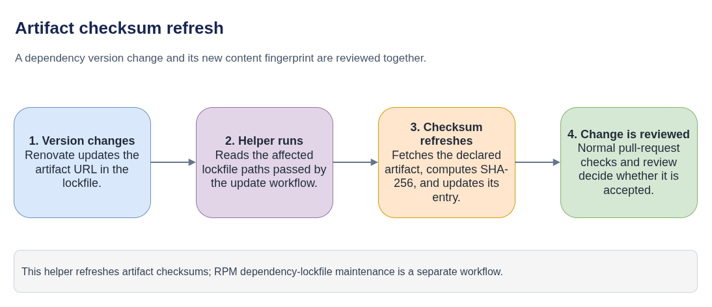

# update-artifacts-lockfile

**Plain-language companion:** [ELI15](eli15.md)

`update-artifacts-lockfile` is a small Python command-line tool that refreshes
checksums in artifact lockfiles after a dependency update changes a download.
It is used in the `coreos-assembler` Renovate/MintMaker flow; it is separate
from the RPM dependency-lockfile workflow.

## Role in the update flow

- [Diagram source](checksum-refresh-flow.drawio)

[Editable Draw.io source](checksum-refresh-flow.drawio)

1. Renovate detects a new artifact version and updates the declared download
   information.
2. The automation invokes `update_artifacts_lockfile` with the changed lockfile
   paths supplied by Renovate.
3. The tool reads those entries, fetches the referenced artifacts, computes
   their SHA-256 checksums, and writes the updated lockfile values.
4. The resulting change is reviewed and checked through the repository's
   normal pull-request workflow.

The current integration uses the `-f` option with
`$RENOVATE_POST_UPGRADE_COMMAND_DATA_FILE`. Check the tool's current README and
release before relying on an invocation or installation version.

## Scope and troubleshooting

The helper updates artifact checksums; it does not build CoreOS images, update
RPM package lockfiles, or bypass review of the resulting dependency change.
When a checksum update fails, check the tool output, target lockfile path,
declared download URL, and the artifact response. Then inspect the matching
Renovate configuration and pull-request checks.

## Related guides

- [Automated lockfile updates in COSA](../coreos-assembler/auto-lockfile-updates/README.md)
- [Python packaging explanation](python-packaging-explained.md)
- [Why the helper is packaged separately](why-so-many-files.md)

## Upstream

- [Tool source and usage](https://github.com/konflux-ci/update-artifacts-lockfile)
- [COSA Renovate configuration](https://github.com/coreos/coreos-assembler/blob/main/renovate.json)
