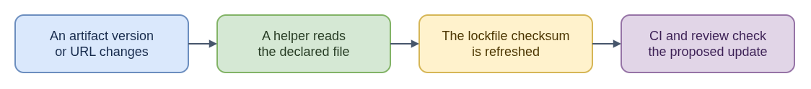

# Artifact Lockfile Updates - ELI15

**Technical guide:** [update-artifacts-lockfile](README.md)

An artifact lockfile records where a build gets an external file and a
fingerprint of that file's exact bytes. If the downloaded bytes differ from
the recorded fingerprint, verification fails instead of silently using a
different file. The fingerprint checks consistency with the lockfile; it does
not by itself prove the download source is trustworthy.

When a dependency bot proposes a new artifact version or URL, this helper
downloads the declared file, calculates its checksum, and updates the lockfile.
If the new artifact has identical bytes, its checksum may remain the same; if
the bytes changed, the new fingerprint records that difference for review.

The tool handles checksum refreshes only. It does not decide whether the new
artifact should be trusted, build an operating system, or update the separate
RPM package lockfile. The resulting change still needs the project's ordinary
checks and review.

- [Diagram source](eli15-flow.drawio)
